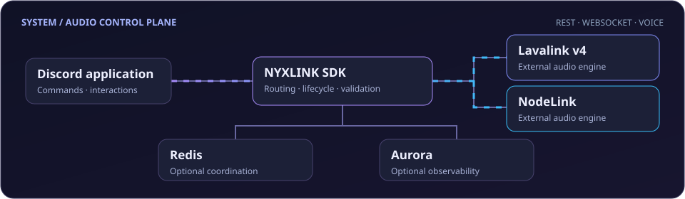
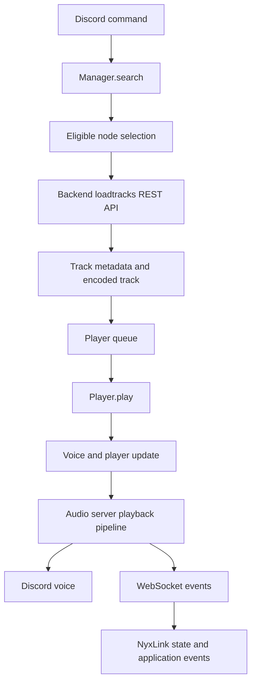
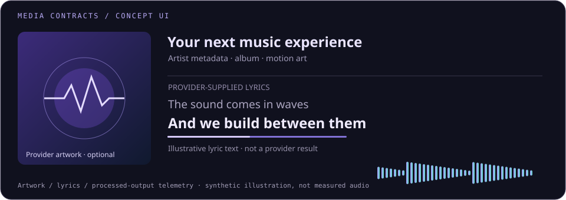
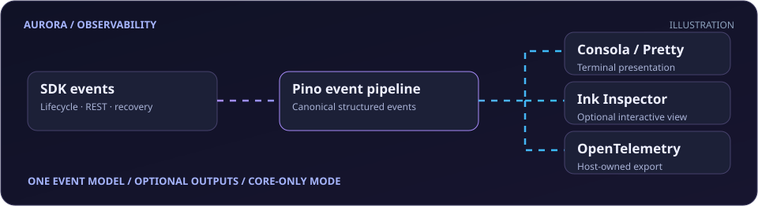
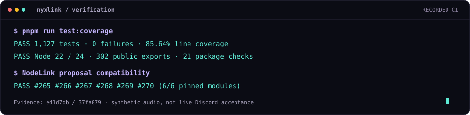
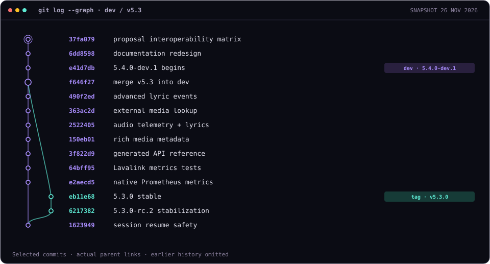

<p align="center">
  
</p>

<h1 align="center">NyxLink</h1>

<p align="center">
  <strong>For the music bots you haven't built yet.</strong><br>
  A TypeScript client for Lavalink v4 &amp; NodeLink.
</p>

<p align="center">
  <a href="https://www.npmjs.com/package/nyxlink"></a>
  <a href="https://www.npmjs.com/package/nyxlink"></a>
  <a href="https://github.com/SebasLoadJs/NyxLink/actions/workflows/pr.yml"></a>
  <a href="https://nodejs.org"></a>
  <a href="LICENSE"></a>
</p>

<p align="center">
  <a href="docs/api-reference.md">Documentation</a> ·
  <a href="#lets-build-something">Getting started</a> ·
  <a href="#two-engines-one-client">Backends</a> ·
  <a href="#meet-aurora">Aurora</a> ·
  <a href="#git-history">History</a> ·
  <a href="docs/readme-es.md">Español</a>
</p>

<p align="center"></p>

---

<table width="100%">
<tr>
<td width="156" align="center" valign="middle"></td>
<td valign="middle">
<h2>Hey, you found NyxLink! ✨</h2>
<p>Maybe you're building your first music bot. Maybe you've already spent a night debugging a player that refused to resume after a node disconnected. Or maybe you want to build an entire music experience, not just a <code>/play</code> command.</p>
<p>NyxLink sits between your Discord application and the audio server. It takes care of the client-side pieces: connecting nodes, tracking players, resolving tracks, managing queues, coordinating recovery and giving you access to the features your backend actually supports.</p>
<p>Your music bot is still yours. Let's make the plumbing a little less distracting.</p>
</td>
</tr>
</table>

## Why another audio client?

<table width="100%">
<tr>
<td valign="middle">
<p>Lavalink and NodeLink are not interchangeable in every detail. A player may support the common v4 protocol but expose different sources, plugins, filters, metadata and native extensions.</p>
<p>We wanted one client that understands those differences instead of pretending they don't exist. NyxLink keeps a common API for everyday playback, exposes backend-specific operations when needed, and makes compatibility an explicit part of routing and recovery.</p>
<p>This project grew out of Moonlink.js. We keep that history and its attribution intact while developing NyxLink's own architecture.</p>
</td>
<td width="156" valign="middle" align="center"></td>
</tr>
</table>

<details>
<summary><strong>Navigate the guide</strong></summary>

- [What can it do?](#what-can-it-do)
- [Two engines, one client](#two-engines-one-client)
- [Let's build something](#lets-build-something)
- [Following a track through NyxLink](#following-a-track-through-nyxlink)
- [Search, queues and playback](#search-queues-and-playback)
- [NodeLink beyond playback](#nodelink-beyond-playback)
- [Lavalink and its plugins](#lavalink-and-its-plugins)
- [When a node goes away](#when-a-node-goes-away)
- [Meet Aurora](#meet-aurora)
- [Dependencies and runtime](#dependencies-and-runtime)
- [Events](#events)
- [Verification](#what-we-actually-test)
- [Git history](#git-history)
- [Documentation and development](#documentation-and-development)

</details>

## What can it do?

- 🎧 **Playback lifecycle** — queues, pause, resume, skip, seek, volume acknowledgement, repeat and autoplay.
- 🔎 **Discovery** — text and URL search, provider-specific discovery, metadata fallback, timeouts, cancellation and bounded caching.
- 🔀 **Multiple nodes** — selection by eligibility, capabilities, load, region, source health and optional weighted cost.
- 🛟 **Recovery** — session resumption, circuit breakers, migration, rollback and cleanup.
- 🎚️ **Audio controls** — common filters, native NodeLink extensions and Lavalink plugin effects.
- 💾 **Persistent state** — in-memory, local and Redis stores, versioned snapshots and distributed guild ownership.
- 🌌 **Aurora** — structured logging, terminal presentation, an optional inspector and host-managed OpenTelemetry.
- 🧩 **Extensions** — typed lifecycle hooks and backend-aware operations without imposing a particular Discord bot architecture.

NyxLink does **not** decode audio, operate its own music catalogue or replace your audio server. It communicates with external engines over REST and WebSocket.

## Two engines, one client

<p align="center"></p>

| | [Lavalink](https://github.com/lavalink-devs/Lavalink) | [NodeLink](https://github.com/PerformanC/NodeLink) |
| --- | --- | --- |
| Protocol | v4 REST / WS | v4-compatible REST / WS |
| Core player controls | Native | Native |
| Extended discovery | LavaSearch + provider plugins | Native search modifiers |
| Track metadata | LavaSrc plugin | Holo Tracks, native pluginInfo |
| Lyrics | LavaLyrics plugin | Native lyrics and subscriptions |
| DSP filters | Common filters + LavaDSPX | Common and native extended filters |
| SponsorBlock | Plugin | Native extension |
| Crossfade, AutoMix, audio layers | Not assumed | Native when supported |
| Stream and format endpoints | Not assumed | Revision/configuration dependent |
| Node selection and recovery | NyxLink | NyxLink |

> [!IMPORTANT]
> Capabilities are not determined by product names alone. A missing plugin, disabled endpoint or older node can make an operation unavailable. NyxLink exposes capability observations and typed errors rather than silently translating unsupported operations.

The tested server profiles include Lavalink 4.2.2 and pinned baseline/modern NodeLink revisions. See [the compatibility record](docs/backend-compatibility.md) for exact versions, plugin scope and limitations.

## Let's build something

<table width="100%">
<tr>
<td width="156" align="center" valign="middle"></td>
<td valign="middle">
<h3>From an empty project to your first track</h3>
<p>You'll need Node.js 22.12 or newer, a Discord application, and an accessible Lavalink v4 or NodeLink server. The SDK is not the audio server, so start your chosen engine first.</p>
<p>New to audio nodes? Start with <a href="https://lavalink.dev/">Lavalink's documentation</a> or <a href="https://nodelink.js.org/">NodeLink's documentation</a>.</p>
</td>
</tr>
</table>

### Install

```bash
npm install nyxlink discord.js@14
```

<details>
<summary>pnpm, Yarn, Bun and release channels</summary>

```bash
pnpm add nyxlink
yarn add nyxlink
bun add nyxlink
```

| npm channel | Command |
| --- | --- |
| Stable | `npm install nyxlink` |
| Release candidate | `npm install nyxlink@next` |
| Published development | `npm install nyxlink@dev` |

Bun is listed as a package manager; this does not certify the Bun runtime. The library's runtime requirement is Node.js. The repository's current source version is 5.4.0-dev.1; published versions are reported by the registry badges, not by the branch name.

</details>

### Configure your bot

Set the environment variables `BOT_TOKEN` and `AUDIO_NODE_PASSWORD`. The host and port in this example are placeholders; use your server's actual address, password and TLS configuration.

```js
const { Client, GatewayIntentBits } = require('discord.js');
const { Manager, Connectors } = require('nyxlink');

const token = process.env.BOT_TOKEN;
const password = process.env.AUDIO_NODE_PASSWORD;

if (!token || !password) {
  throw new Error('Set BOT_TOKEN and AUDIO_NODE_PASSWORD.');
}

const client = new Client({
  intents: [GatewayIntentBits.Guilds, GatewayIntentBits.GuildVoiceStates],
});

const nodes = [{
  identifier: 'main',
  host: 'localhost',
  port: 3000,
  password,
  secure: false,
}];

const manager = new Manager({
  nodes,
  options: {
    database: { type: 'memory' },
    resume: false,
  },
});

manager.use(new Connectors.DiscordJs(), client);

manager.on('nodeReady', node => {
  console.log(`Node connected: ${node.identifier}`);
});

manager.on('nodeError', (node, error) => {
  console.error(`[${node.identifier}] ${error.message}`);
});

manager.on('trackStart', (player, track) => {
  console.log(`[${player.guildId}] Playing: ${track.title}`);
});

client.login(token).catch(console.error);
```

Register the Discord connector before login. Wait for `nodeReady` before attempting commands that need a usable node session.

> [!TIP]
> Prefer TypeScript? The root package ships declarations and can be imported from ESM or CommonJS. See [the TypeScript example](examples/discordjs.ts) and [the JavaScript example](examples/discordjs.cjs).

### Your first playback command

```js
async function play(guildId, voiceChannelId, query, requester) {
  const result = await manager.search({
    query,
    requester,
    signal: AbortSignal.timeout(10000),
  });

  if (!result.tracks.length) {
    throw new Error(result.exception?.message ?? 'No tracks found.');
  }

  const player = manager.players.get(guildId)
    ?? manager.players.create({ guildId, voiceChannelId, volume: 50 });

  if (player.voiceChannelId !== voiceChannelId) {
    throw new Error('The player is connected to a different voice channel.');
  }

  player.queue.add(result.tracks[0]);

  if (!player.playing && !player.paused && !(await player.play())) {
    throw new Error('The node did not acknowledge playback.');
  }

  return player;
}
```

This handler assumes the application has already checked permissions and obtained the user's voice channel ID. The application still owns its commands and Discord UI.

## Following a track through NyxLink

Here's the path of a request from the moment someone types a song name to the moment the audio server reports playback.



1. **Discover.** The Manager selects an eligible node and sends the search request. Provider-specific discovery can also return artists, albums and playlists that are not themselves playable tracks.
2. **Resolve.** NyxLink validates the response and keeps the track's original encoded data and plugin metadata. When moving to another backend, resolution follows the destination's supported sources rather than assuming the old encoding is portable.
3. **Queue.** The Player owns a queue and exposes explicit playback operations. Commands remain ordered and old operations cannot overwrite a newer playback intent.
4. **Play.** The client coordinates player updates and voice state through the backend API. The server owns decoding, processing and packet delivery.
5. **Observe.** WebSocket events and player state inform your bot's user interface, storage and diagnostics. A REST acknowledgement is not an audible playback measurement.
6. **Recover.** If a node fails, the SDK selects an eligible destination, prepares compatible state and commits migration only after the required acknowledgements.

[Public API](docs/api-reference.md) · [Node selection](docs/node-selection.md) · [Backend contracts](docs/backend-compatibility.md)

## Search, queues and playback

### Discovery and metadata

```ts
const result = await manager.search({
  query: 'Daft Punk',
  source: 'spotify',
  signal: AbortSignal.timeout(10000),
});

const track = result.tracks[0];
const lava = track?.getLavaSrcMetadata();
const holo = track?.getHoloMetadata();
const collection = result.getLavaSrcMetadata();
```

The source must be supported by the selected node. International source prefixes available in the inspected NodeLink contracts include `azsearch` (Amazon Music), `lfsearch` (Last.fm), `shsearch` (Shazam) and `slsearch` (Songlink). Discovery and link resolution do not necessarily provide playable audio.

### Playback controls

| Operation | Method |
| --- | --- |
| Pause / resume | `await player.pause()` / `await player.resume()` |
| Skip | `await player.skip()` |
| Seek to one minute | `await player.seek(60000)` |
| Confirm volume | `await player.setVolumeAsync(50)` |
| Repeat | `player.setLoop('track')`, `'queue'`, `'off'` |
| Autoplay | `player.setAutoPlay(true)` |
| Stop / destroy | `await player.stop()` / `await player.destroy()` |
| Transfer | `await player.transferNode(identifier)` |

For playlists, enqueue `result.tracks` rather than only the first track. Check operation return values and errors before announcing success to your users.

## NodeLink beyond playback

NodeLink's native extensions are intentionally exposed as backend-specific operations.

### Lyrics and source health

```ts
const health = await node.getSourceHealth();

const lyrics = await node.loadLyrics(track, {
  lang: 'es',
  type: 'lyrics',
});
```

Lyrics and captions depend on enabled providers. Source health is an observation with a freshness window, not a permanent declaration that a provider works.

### Crossfade, AutoMix and mixing

- `player.setCrossfade(options)` configures the native transition.
- `player.setNextTrack(track)` prepares an explicit next track.
- `player.setQueuePreload({ enabled: true, leadMs: 35000 })` enables queue-backed preload.
- `player.addMix(track, { volume: 0.25 })`, `getMixes()`, `updateMixVolume()` and `removeMix()` manage native audio layers.

AutoMix analysis belongs to the server; NyxLink does not create its own mixing engine. Audio layer recovery is opt-in and can restart layers rather than preserving their exact position. See [mixer semantics](docs/mixer.md).

### Formats and streams

```ts
const formats = await node.getStreamFormats(track);
const { stream, headers, statusCode } = await node.loadSourceStream(track, {
  range: 'bytes=0-65535',
});

// Consume the stream, or destroy it when no longer needed.
```

Source passthrough and decoded PCM are different transports. An HTTP 200 response does not establish that a Range was honored. The known HTTP WAV seek incident is tracked in [the seek investigation](docs/nodelink-seek-incident.md).

### 5.4: building richer music experiences

<p align="center"></p>

The development branch includes optional contracts for rich media metadata, advanced lyric observations, output visualization, musical analysis and Protected audio telemetry. These consume payloads from the corresponding NodeLink proposals; older nodes may omit them entirely.

```ts
import {
  readNodeLinkPlayerTelemetry,
  readNodeLinkLyricsEvent,
} from 'nyxlink';

const media = track.getNodeLinkMediaMetadata();
const artistArtwork = media?.artists[0]?.artwork;
const albumArtwork = media?.album?.artwork;

const playerState = await node.rest.getPlayer(guildId);
const telemetry = readNodeLinkPlayerTelemetry(playerState);

manager.on('lyricsLine', (_player, raw) => {
  const event = readNodeLinkLyricsEvent(raw);
  if (event?.kind === 'line') {
    console.log(event.line.line, event.activeLineIndices);
  }
});
```

| Proposal | What the application can consume |
| --- | --- |
| [#265 Rich media](https://github.com/PerformanC/NodeLink/pull/265) | Artist/album imagery, motion artwork, colours, credits and explicit MusicBrainz/Fanart.tv lookup via `node.loadMedia()` |
| [#266 Lyrics](https://github.com/PerformanC/NodeLink/pull/266) | Provider timing, words, annotations, overlapping voices, supplied alternatives |
| [#267 Visualization](https://github.com/PerformanC/NodeLink/pull/267) | Stereo RMS/peak, waveform envelope and frequency probes |
| [#268 Music analysis](https://github.com/PerformanC/NodeLink/pull/268) | Estimated tempo, key, energy and onset/beat positions |
| [#269 Protected audio](https://github.com/PerformanC/NodeLink/pull/269) | Resource gain and limiter telemetry |
| [#270 AutoMix](https://github.com/PerformanC/NodeLink/pull/270) | Server-side transition safeguards |

> [!NOTE]
> All six pinned proposal module checks passed on 26 November 2026 using synthetic PCM/data. The proposals are not an official upstream release, and these checks do not establish real provider or Discord voice availability. The illustration above is a possible UI, not a shipped music player or live screenshot.

[Proposal interoperability evidence](https://github.com/SebasLoadJs/NyxLink/actions/runs/45907683272) · [Integration audit](docs/nodelink-5.4-upstream-audit.md)

## Lavalink and its plugins

Lavalink remains a first-class backend. Plugin features use their own contracts instead of being treated as equivalent to unrelated NodeLink endpoints.

### LavaSearch and LavaSrc

```ts
if (node.backend?.supports('lavasearch')) {
  const results = await node.loadSearch('spsearch:Architects', {
    types: ['track', 'album', 'artist', 'playlist', 'text'],
    signal: AbortSignal.timeout(10000),
  });
}
```

### Lyrics and DSP

```ts
const lyrics = await node.getLavaLyrics(track, {
  skipTrackSource: false,
});

if (player.node.backend?.supports('lavadspx')) {
  player.filters.setLavaDSPX('high-pass', { cutoffFrequency: 80 });
  await player.filters.apply();
}
```

Plugin names, installed versions and provider configuration determine availability. Read [Lavalink support](docs/lavalink.md) for SponsorBlock, LavaLyrics, LavaSrc metadata and filter semantics.

## When a node goes away

Playback state and backend-specific capabilities are different things. A destination might support ordinary playback while not supporting the current source's mixer, filters or native transitions.

NyxLink's routing checks eligibility before ranking nodes, retains compatible playback state, suspends unsupported preferences and reports migration progress. On a failed transaction, the old player is not discarded just because a destination was selected.

```js
const manager = new Manager({
  nodes,
  options: {
    database: { type: 'memory' },
    resume: true,
    search: {
      defaultPlatform: 'youtube',
      timeoutMs: 10000,
      resultLimit: 10,
      fallbackPlatforms: ['soundcloud'],
      cache: { ttlMs: 30000, maxEntries: 100 },
    },
    node: {
      selectionStrategy: 'leastLoad',
      autoMovePlayers: true,
      failover: { maxAttempts: 2, retryDelayMs: 250 },
      circuitBreaker: {
        failureThreshold: 3,
        windowMs: 30000,
        cooldownMs: 30000,
      },
    },
  },
});
```

For callers that need a particular backend or capability:

```ts
const destination = manager.nodes.findNode({
  backend: 'nodelink',
  requiredCapabilities: ['nextTrack'],
  region: 'eu',
  preferSource: 'youtube',
});
```

The selection does not initiate a migration by itself. It returns an eligible node or no match. Distributed applications can use Redis ownership and versioned player snapshots; see [Redis](docs/redis-storage.md) and [node selection](docs/node-selection.md).

## Meet Aurora

<p align="center"></p>

Logs should help you understand the music system, not drown you in it. Aurora organizes SDK events into one canonical Pino pipeline and lets the host choose the presentation and telemetry destinations.

The core is silent by default. Consola, Pino Pretty, Ink and OpenTelemetry are selected explicitly rather than starting terminal renderers or telemetry exporters at import time.

```ts
import { Manager } from 'nyxlink';
import { createAuroraPipeline } from 'nyxlink/aurora';

const aurora = createAuroraPipeline({
  format: 'aurora',
  level: 'info',
});

const manager = new Manager({
  nodes,
  options: {
    logging: { level: aurora.level, target: aurora.target },
  },
});

aurora.banner(manager);
// Register the Discord connector and use the manager in your application.

// On application shutdown:
await manager.shutdown();
await aurora.close();
```

<details>
<summary><strong>All Aurora entry points and optional tools</strong></summary>

| Entry | What it gives you |
| --- | --- |
| `nyxlink/aurora` | Aurora, Pretty, JSON, Custom and Silent outputs |
| `nyxlink/aurora/bootstrap` | Startup and readiness observation |
| `nyxlink/aurora/diagnostics` | Music snapshots and incident tables |
| `nyxlink/aurora/inspector` | Read-only interactive Ink inspector |
| `nyxlink/aurora/file` | Bounded private NDJSON destination |
| `nyxlink/aurora/otel` | Event/span correlation |
| `nyxlink/aurora/sdk` | Explicit host SDK and telemetry lifecycle |

Pino handles canonical events; Consola, Chalk, Figlet, gradient-string, Boxen and related tools provide optional terminal presentation. Ink/React power the optional inspector. OpenTelemetry is host-owned.

Install the dependencies for the profile you actually use from [Aurora installation](docs/aurora-installation.md). The root SDK does not require React or the optional terminal packages.

</details>

Try the demonstration after installing its required optional dependencies:

```sh
npx nyxlink-aurora --scenario all --snapshot
```

The scenario is simulated. It illustrates diagnostic output, not a measurement of a live bot.

## Dependencies and runtime

NyxLink keeps the root runtime small in scope and leaves optional presentation/telemetry to the application.

| Layer | Packages |
| --- | --- |
| Core | [Pino](https://github.com/pinojs/pino), [Consola](https://github.com/unjs/consola) |
| Formatting | Pino Pretty, Chalk, Figlet, gradient-string, Boxen |
| Terminal UI | Ink, React, Fuse.js, Listr2, Ora and terminal utilities |
| Observability | OpenTelemetry API, SDK and optional OTLP exporters |
| Development | TypeScript, Node test runner, Tinybench |

The full pinned dependency inventory is in [package.json](package.json) and [pnpm-lock.yaml](pnpm-lock.yaml). Optional dependencies are not all installed automatically for consumers.

## Events

Your bot decides what to do with playback events — update a now-playing message, display lyrics, update a web player or record an operational metric.

```ts
manager.on('nodeReady', node => {
  console.log('Ready:', node.identifier);
});

manager.on('trackStart', (player, track) => {
  console.log(player.guildId, track.title);
});

manager.on('playerNodeFailover', (player, report) => {
  // Use the report to inspect migration and suspended features.
  console.log(player.guildId, report);
});
```

| Event | Meaning |
| --- | --- |
| `nodeReady`, `nodeResume`, `nodeDisconnect` | Node lifecycle |
| `trackStart`, `trackEnd`, `trackException` | Track lifecycle |
| `queueEnd`, `autoPlayed` | Queue and autoplay |
| `playerNodeFailover`, `playerDestroy` | Recovery and cleanup |
| `mixStart`, `mixEnd` | Native audio layers |
| `lyricsFound`, `lyricsLine`, `lyricsNotFound` | Native lyric events |
| `sponsorBlockEvent` | Normalized segments and chapters |

Full signatures: [IManagerEvents](src/typings/Interfaces.ts) and [generated declarations](docs/api-generated.md).

## What we actually test

<a href="https://github.com/SebasLoadJs/NyxLink/actions/runs/45907232634"></a>

Recorded checkpoints, not claims about every later commit:

- Node.js 22 and 24: 1,127 unit/contract tests, zero failures; public declarations and 21 package checks passed on `e41d7db`.
- CodeQL, Redis and pinned local backend tests passed on that revision.
- All six exact NodeLink proposal module tests passed on `37fa079`.
- Real voice, source credentials, audible AutoMix transitions and release-specific acceptance remain separate.

[Live CI status](https://github.com/SebasLoadJs/NyxLink/actions?query=branch%3Adev) · [Acceptance record](docs/pending-real-world-acceptance.md)

## Git history

NyxLink is not a repository with a history invented for its README. Its Git lineage includes Moonlink's inherited commits, the early development packages, the 5.3 stabilization and the 5.4 development branch.

<a href="https://github.com/SebasLoadJs/NyxLink/commits/dev"></a>

| Milestone | Date |
| --- | --- |
| [Inherited lineage and legacy tags](https://github.com/SebasLoadJs/NyxLink/tags) | Historical |
| [v0.1.0-dev.2](https://github.com/SebasLoadJs/NyxLink/releases/tag/v0.1.0-dev.2) | 03 Nov 2026 |
| [v5.3.0-rc.1](https://github.com/SebasLoadJs/NyxLink/releases/tag/v5.3.0-rc.1) | 24 Nov 2026 |
| [v5.3.0-rc.2](https://github.com/SebasLoadJs/NyxLink/releases/tag/v5.3.0-rc.2) | 25 Nov 2026 |
| [v5.3.0](https://github.com/SebasLoadJs/NyxLink/releases/tag/v5.3.0) | 25 Nov 2026 |
| [5.4 development starts](https://github.com/SebasLoadJs/NyxLink/commit/e41d7db500f32d40b322ca92ffd3c9b3c5cf22a9) | 26 Nov 2026 |

The graph is a selected, dated snapshot of real parent links. Older inherited tags are not proof that NyxLink published packages with those same version numbers.

<p align="center">
  <a href="https://github.com/SebasLoadJs/NyxLink/commits/dev">All commits</a> ·
  <a href="https://github.com/SebasLoadJs/NyxLink/network">Network graph</a> ·
  <a href="https://github.com/SebasLoadJs/NyxLink/compare/v5.3.0...dev">Compare stable to dev</a> ·
  <a href="CHANGELOG.md">Changelog</a>
</p>

## Documentation and development

| Guide | Start here |
| --- | --- |
| SDK | [API reference](docs/api-reference.md) · [Generated declarations](docs/api-generated.md) |
| Examples | [JavaScript](examples/discordjs.cjs) · [TypeScript](examples/discordjs.ts) |
| Backends | [NodeLink](docs/nodelink.md) · [Lavalink](docs/lavalink.md) · [Compatibility](docs/backend-compatibility.md) |
| Recovery | [Node selection](docs/node-selection.md) · [Redis](docs/redis-storage.md) |
| Extensions | [Mixer](docs/mixer.md) · [Extension lifecycle](docs/extensions.md) |
| Aurora | [Installation](docs/aurora-installation.md) · [Logging](docs/logging-guide.md) · [Observability](docs/aurora-observability.md) |
| Migration | [From Moonlink](docs/migrating-from-moonlink.md) |
| Release | [5.4 runbook](docs/release-5.4-runbook.md) · [Changelog](CHANGELOG.md) |

To work on NyxLink:

```sh
git clone https://github.com/SebasLoadJs/NyxLink.git
cd NyxLink
corepack pnpm install --frozen-lockfile
pnpm run build
pnpm test
pnpm run test:types
pnpm run test:package
pnpm run pack:check
```

Backend integration needs Linux and Docker/Podman. Contributions should preserve the public contract, include relevant tests and distinguish the evidence they actually collected from cases that remain untested.

## The people behind the project

<table width="100%">
<tr>
<td width="120" align="center"><a href="https://github.com/SebasLoadJs"></a></td>
<td><strong><a href="https://github.com/SebasLoadJs">SebasLoadJs</a></strong><br>NyxLink maintainer.</td>
</tr>
<tr>
<td width="120" align="center"><a href="https://github.com/1Lucas1apk"></a></td>
<td><strong><a href="https://github.com/1Lucas1apk">1Lucas1apk</a> &amp; Moonlink contributors</strong><br>Original project lineage and upstream foundations.</td>
</tr>
</table>

<p align="center">
  <a href="https://github.com/SebasLoadJs/NyxLink/graphs/contributors"></a>
</p>

<p align="center"><sub>Contributor visualization includes inherited Git history; it does not imply active NyxLink maintainership.</sub></p>

### Project growth

<p align="center"><a href="https://star-history.com/#SebasLoadJs/NyxLink&amp;Date"></a></p>

## License

NyxLink is distributed under the [Open Software License 3.0](LICENSE), derived from [Moonlink.js](https://github.com/Ecliptia/moonlink.js). [NOTICE.md](NOTICE.md) records upstream attribution and modifications.

<p align="center"></p>
<p align="center"><strong>Now go build something worth listening to.</strong><br><sub>Thanks for visiting NyxLink.</sub></p>
