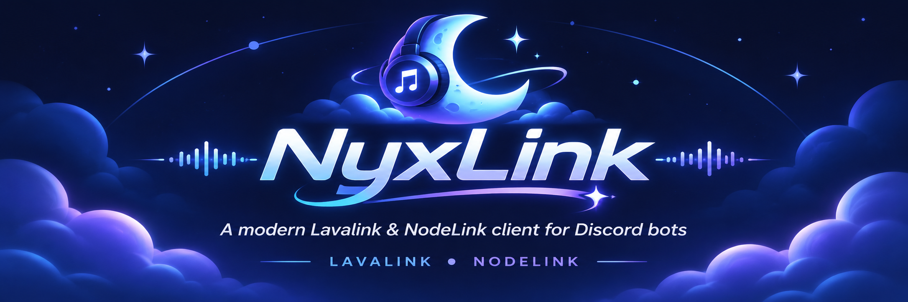
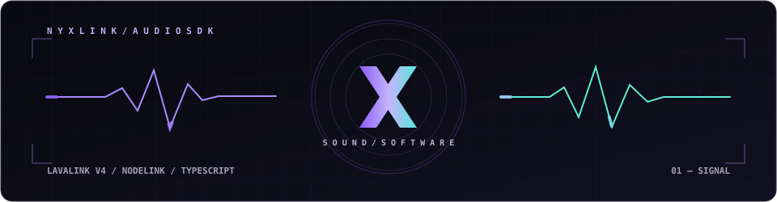

<div align="center">





<h3>Audio infrastructure for Discord.</h3>
<p>One TypeScript client for Lavalink &amp; NodeLink.</p>

<a href="https://www.npmjs.com/package/nyxlink"></a>
<a href="https://github.com/SebasLoadJs/NyxLink/actions/workflows/pr.yml"></a>
<a href="https://www.npmjs.com/package/nyxlink"></a>
<a href="LICENSE"></a>

<br>

[**Quick start**](#quick-start) · [**API**](docs/api-reference.md) · [**Aurora**](#aurora) · [**History**](#git-history) · [**Releases**](https://github.com/SebasLoadJs/NyxLink/releases) · [**Español**](README.es.md)

</div>

---

## 01 / Get connected

NyxLink manages nodes, players, queues, sessions and failover for external audio engines. Keep your bot focused on the experience; let the SDK handle the control plane.

```sh
npm install nyxlink
```

<details>
<summary>Other package managers &amp; release channels</summary>

```sh
pnpm add nyxlink
yarn add nyxlink

npm install nyxlink@next  # published release candidate
npm install nyxlink@dev   # published development package
```

Requires Node.js 22.12+ and a running Lavalink v4 or NodeLink server. The `dev` source line is 5.4.0-dev.1; it is not yet published to npm.

</details>

<a id="quick-start"></a>

## 02 / Quick start

Install `discord.js@14` alongside NyxLink. Set `BOT_TOKEN` and `AUDIO_NODE_PASSWORD` in your environment.

```js
const { Client, GatewayIntentBits } = require('discord.js');
const { Manager, Connectors } = require('nyxlink');

const client = new Client({
  intents: [GatewayIntentBits.Guilds, GatewayIntentBits.GuildVoiceStates],
});

const manager = new Manager({
  nodes: [{
    identifier: 'audio',
    host: 'localhost',
    port: 3000,
    password: process.env.AUDIO_NODE_PASSWORD,
    secure: false,
  }],
  options: { database: { type: 'memory' }, resume: false },
});

manager.use(new Connectors.DiscordJs(), client);

manager.on('trackStart', (player, track) => {
  console.log(`Now playing: ${track.title}`);
});

client.login(process.env.BOT_TOKEN);
```

Once the node is ready, search, queue and start playback from your command handler.

```ts
const result = await manager.search({ query, requester });
if (!result.tracks.length) return;

const player = manager.players.get(guildId)
  ?? manager.players.create({ guildId, voiceChannelId, volume: 50 });

player.queue.add(result.tracks[0]);
if (!player.playing && !player.paused) await player.play();
```

[Full JavaScript example](examples/discordjs.cjs) · [TypeScript example](examples/discordjs.ts) · [Complete usage guide](README.guide.md)

## 03 / Designed for more than playback

**Playback** — queues, repeat, autoplay, filters, seek, volume acknowledgement and track lifecycle.

**Resilience** — capability-aware routing, circuit breakers, session recovery, migration and rollback.

**Backend extensions** — Lavalink plugins, NodeLink discovery, lyrics, mixer, crossfade and streams, when supported.

**Distributed state** — memory, local persistence, Redis and guild ownership.

<details>
<summary>Explore backend support &amp; SDK contracts</summary>

- [Lavalink &amp; plugins](docs/lavalink.md)
- [NodeLink extensions](docs/nodelink.md)
- [Backend compatibility](docs/backend-compatibility.md)
- [Node selection &amp; failover](docs/node-selection.md)
- [Redis storage](docs/redis-storage.md)
- [Public API declarations](docs/api-generated.md)

</details>

### 5.4 / In development

Rich artist and album metadata · Motion artwork · Advanced lyrics · Visualization · Musical analysis · Protected audio telemetry.

These are optional contracts for the six open NodeLink proposals, not a claim that every official server supports them. All six pinned module interoperability jobs passed using synthetic inputs; full server/provider and live voice acceptance remain separate.

[**Upstream integration audit**](docs/nodelink-5.4-upstream-audit.md) · [**6/6 proposal checks**](https://github.com/SebasLoadJs/NyxLink/actions/runs/45907683272)

## Aurora

Structured events, expressive terminals and host-managed telemetry. One Pino pipeline; optional Consola presentation, Ink Inspector and OpenTelemetry.

```sh
npx nyxlink-aurora --scenario all --snapshot
```

The demo uses simulated events. [Installation](docs/aurora-installation.md) · [Logging](docs/logging-guide.md) · [Observability](docs/aurora-observability.md)

## 04 / Verified, not assumed

<a href="https://github.com/SebasLoadJs/NyxLink/actions/runs/45907232634"></a>

[SDK CI](https://github.com/SebasLoadJs/NyxLink/actions/runs/45907232634) · [Proposal CI](https://github.com/SebasLoadJs/NyxLink/actions/runs/45907683272) · [Real-world acceptance](docs/pending-real-world-acceptance.md)

<a id="git-history"></a>

## 05 / Git history

<a href="https://github.com/SebasLoadJs/NyxLink/commits/dev"></a>

[**All commits**](https://github.com/SebasLoadJs/NyxLink/commits/dev) · [**Network**](https://github.com/SebasLoadJs/NyxLink/network) · [**Tags**](https://github.com/SebasLoadJs/NyxLink/tags) · [**Contributors**](https://github.com/SebasLoadJs/NyxLink/graphs/contributors) · [**Changelog**](CHANGELOG.md)

<details>
<summary>Release lineage</summary>

- [v0.1.0-dev.2](https://github.com/SebasLoadJs/NyxLink/releases/tag/v0.1.0-dev.2) · 03 Nov 2026
- [v5.3.0-rc.1](https://github.com/SebasLoadJs/NyxLink/releases/tag/v5.3.0-rc.1) · 24 Nov 2026
- [v5.3.0-rc.2](https://github.com/SebasLoadJs/NyxLink/releases/tag/v5.3.0-rc.2) · 25 Nov 2026
- [v5.3.0](https://github.com/SebasLoadJs/NyxLink/releases/tag/v5.3.0) · 25 Nov 2026 — stable
- [5.4 development](https://github.com/SebasLoadJs/NyxLink/commit/e41d7db500f32d40b322ca92ffd3c9b3c5cf22a9) · 26 Nov 2026 — source only

Older inherited tags remain part of the Moonlink lineage; they are not proof of equivalent NyxLink npm publications.

</details>

## 06 / Explore the SDK

[Complete guide](README.guide.md) · [API reference](docs/api-reference.md) · [Generated types](docs/api-generated.md) · [Development & release gates](docs/release-5.4-runbook.md) · [Migration from Moonlink](docs/migrating-from-moonlink.md)

---

<div align="center">

**NYXLINK** · Maintained by [SebasLoadJs](https://github.com/SebasLoadJs)

Based on [Moonlink.js](https://github.com/Ecliptia/moonlink.js) by 1Lucas1apk and contributors.  
[OSL-3.0 License](LICENSE) · [Attributions](NOTICE.md) · [npm](https://www.npmjs.com/package/nyxlink)

</div>
