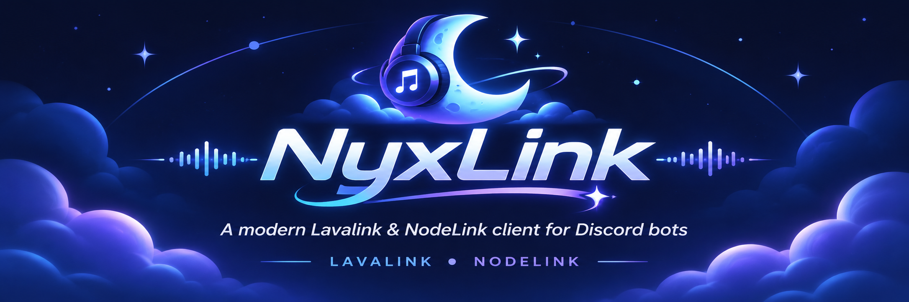
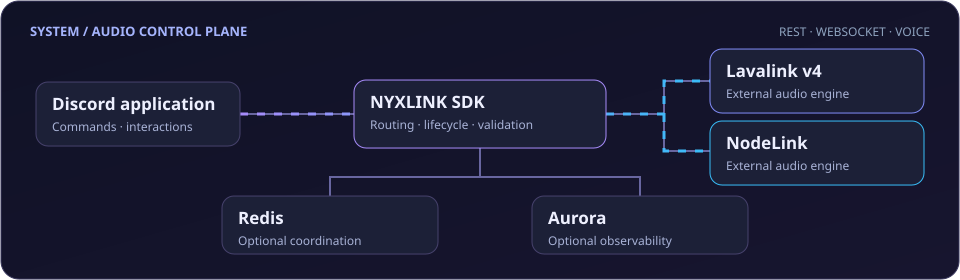
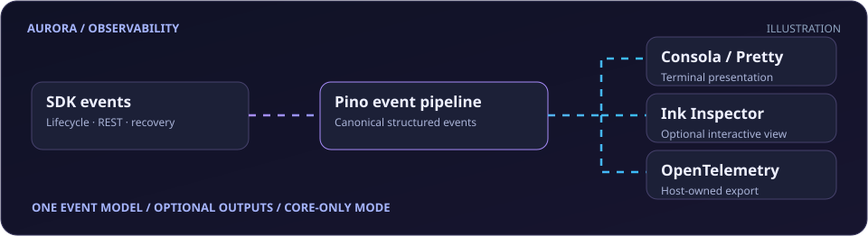
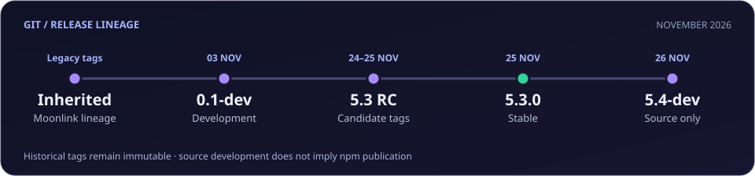

<p align="center">
  
</p>

<h1 align="center">NyxLink · Complete SDK guide</h1>
<p align="center"><a href="../README.md">Return to project overview</a></p>

<p align="center"><strong>One client. Two audio engines. A single control plane.</strong></p>
<p align="center">A TypeScript SDK for building Discord music experiences with Lavalink v4 and NodeLink.</p>

<p align="center">
  <a href="https://www.npmjs.com/package/nyxlink"></a>
  <a href="https://www.npmjs.com/package/nyxlink"></a>
  <a href="https://www.npmjs.com/package/nyxlink"></a>
  <a href="https://github.com/SebasLoadJs/NyxLink/actions/workflows/pr.yml"></a>
</p>
<p align="center">
  <a href="https://nodejs.org"></a>
  <a href="https://www.typescriptlang.org"></a>
  <a href="https://discord.js.org"></a>
  <a href="../LICENSE"></a>
  <a href="https://github.com/SebasLoadJs/NyxLink/stargazers"></a>
</p>

<p align="center"><a href="#installation">Installation</a> · <a href="#quick-start">Quick start</a> · <a href="#architecture">Architecture</a> · <a href="#aurora">Aurora</a> · <a href="#git-history">Git history</a> · <a href="#documentation">Docs</a> · <a href="readme-es.md">Español</a></p>
<p align="center"></p>

---

## Built for the audio control plane

NyxLink is a typed client for external audio servers, not an audio encoder or a streaming service. Its job is to coordinate playback, voice state, search, sessions, failover and provider-specific capabilities while keeping the application-facing API coherent.

<table>
<tr>
<td width="50%" valign="top"><h3>◈ Playback &amp; discovery</h3>Queues, filters, repeat, autoplay, seek, volume acknowledgements, source routing and optional metadata resolution.</td>
<td width="50%" valign="top"><h3>◇ Resilient multi-node routing</h3>Capability-aware node selection, circuit breakers, recovery, session resumption and player migration.</td>
</tr>
<tr>
<td valign="top"><h3>◈ Distributed state</h3>Memory, local and Redis storage, snapshots, guild ownership and fenced coordination.</td>
<td valign="top"><h3>◇ Aurora observability</h3>Canonical Pino events, Consola presentation, optional interactive diagnostics and host OpenTelemetry.</td>
</tr>
</table>

## Architecture

<p align="center"></p>

- **Application:** owns commands, permissions, Discord interaction and UI.
- **NyxLink:** owns SDK control, routing, protocol validation and lifecycle.
- **Audio servers:** own source resolution, decoding, DSP and Discord audio delivery.
- **Optional infrastructure:** Redis coordination and host-managed OpenTelemetry.

## Installation

Requires **Node.js 22.12+** and a running Lavalink v4 or NodeLink server.

```sh
npm install nyxlink
# or
pnpm add nyxlink
yarn add nyxlink
```

For Discord.js integration: `npm install discord.js@14`.

| Channel | Install | Purpose |
| --- | --- | --- |
| Stable | `npm install nyxlink` | Production release (`latest`) |
| Candidate | `npm install nyxlink@next` | Published release candidate |
| Development | `npm install nyxlink@dev` | Published development build |

> [!NOTE]
> The `dev` branch currently targets **5.4.0-dev.1**. A source version is not an npm publication. The badges above reflect the registry, not the branch manifest.

## Quick start

Configure `BOT_TOKEN` and `AUDIO_NODE_PASSWORD` in the environment. Adjust the address, port and TLS settings to your audio server.

```js
const { Client, GatewayIntentBits } = require('discord.js');
const { Manager, Connectors } = require('nyxlink');

const token = process.env.BOT_TOKEN;
const password = process.env.AUDIO_NODE_PASSWORD;

if (!token || !password) {
  throw new Error('Configura BOT_TOKEN y AUDIO_NODE_PASSWORD.');
}

const client = new Client({
  intents: [GatewayIntentBits.Guilds, GatewayIntentBits.GuildVoiceStates],
});

const nodes = [{
  identifier: 'principal',
  host: 'localhost',
  port: 3000,
  password,
  secure: false,
}];

const manager = new Manager({
  nodes,
  options: {
    database: { type: 'memory' },
    resume: false,
  },
});

manager.use(new Connectors.DiscordJs(), client);

manager.on('nodeReady', node => {
  console.log(`Nodo conectado: ${node.identifier}`);
});

manager.on('nodeError', (node, error) => {
  console.error(`[${node.identifier}] ${error.message}`);
});

manager.on('trackStart', (player, track) => {
  console.log(`[${player.guildId}] Reproduciendo: ${track.title}`);
});

client.login(token).catch(console.error);
```

Register the Discord connector before login. `nodeReady` signals that the node session is available.

## Playback

```js
async function play(guildId, voiceChannelId, query, requester) {
  const result = await manager.search({
    query,
    requester,
    signal: AbortSignal.timeout(10000),
  });

  if (!result.tracks.length) {
    throw new Error(result.exception?.message ?? 'No se encontraron pistas.');
  }

  const player = manager.players.get(guildId)
    ?? manager.players.create({ guildId, voiceChannelId, volume: 50 });

  if (player.voiceChannelId !== voiceChannelId) {
    throw new Error('El reproductor está conectado a otro canal de voz.');
  }

  player.queue.add(result.tracks[0]);

  if (!player.playing && !player.paused && !(await player.play())) {
    throw new Error('El nodo no aceptó la reproducción.');
  }

  return player;
}
```

Search accepts text or URLs. Queue an entire playlist with `player.queue.add(result.tracks)`.

| Operation | API |
| --- | --- |
| Pause / resume | `await player.pause()` / `await player.resume()` |
| Skip / seek | `await player.skip()` / `await player.seek(60000)` |
| Volume / stop | `await player.setVolumeAsync(50)` / `await player.stop()` |
| Repeat / autoplay | `player.setLoop('track')` / `player.setAutoPlay(true)` |
| Migration / cleanup | `await player.transferNode(identifier)` / `await player.destroy()` |

Playback acknowledgement is not proof that audio was heard in Discord. See the [API guide](../docs/api-reference.md) for lifecycle, return values and error handling.

## Backend compatibility

| Capability | Lavalink v4 | NodeLink |
| --- | --- | --- |
| Core playback, tracks, sessions | Native | Native |
| Discovery &amp; metadata | LavaSearch, LavaSrc | Native discovery, Holo |
| Lyrics | LavaLyrics plugin | Native lyrics and subscriptions |
| Audio filters | Native and LavaDSPX | Native and backend-specific filters |
| SponsorBlock | Plugin | Native extension |
| Crossfade, mixer, streams, groups | Not assumed | Capability-dependent |
| Failover &amp; recovery | SDK orchestration | SDK orchestration |

The exact server revision, installed plugins and enabled sources determine availability. NyxLink does not pretend an unsupported operation exists. See [backend compatibility](../docs/backend-compatibility.md), [Lavalink](../docs/lavalink.md) and [NodeLink](../docs/nodelink.md).

### 5.4 · experimental media contracts

The following examples target the **development source**, not the existing stable npm package. They depend on the corresponding server payloads and are optional.

```ts
import {
  readNodeLinkPlayerTelemetry,
  readNodeLinkLyricsEvent,
} from 'nyxlink';

const media = track.getNodeLinkMediaMetadata();
const artwork = media?.artists[0]?.artwork;

const snapshot = await node.rest.getPlayer(guildId);
const telemetry = readNodeLinkPlayerTelemetry(snapshot);

manager.on('lyricsLine', (_player, payload) => {
  const event = readNodeLinkLyricsEvent(payload);
  if (event?.kind === 'line') {
    console.log(event.line.line, event.activeLineIndices);
  }
});
```

| Proposal | SDK surface |
| --- | --- |
| [#265 Rich media](https://github.com/PerformanC/NodeLink/pull/265) | Artist/album imagery, motion artwork, credits, explicit `node.loadMedia()` |
| [#266 Advanced lyrics](https://github.com/PerformanC/NodeLink/pull/266) | Timing, word metadata, simultaneous vocals, provider alternatives |
| [#267 Visualization](https://github.com/PerformanC/NodeLink/pull/267) | Optional stereo waveform and frequency snapshots |
| [#268 Music analysis](https://github.com/PerformanC/NodeLink/pull/268) | Estimated tempo/key, energy, onset and beat positions |
| [#269 Protected processing](https://github.com/PerformanC/NodeLink/pull/269) | Optional resource telemetry |
| [#270 AutoMix safety](https://github.com/PerformanC/NodeLink/pull/270) | Server-side changes; client/live acceptance still pending |

See the [upstream integration audit](../docs/nodelink-5.4-upstream-audit.md). The above proposals are not a claim of official upstream release or provider availability.

## Aurora

<p align="center"></p>

A single structured event pipeline, with optional presentation and observability tools. The core does not require React or an interactive terminal.

Install the optional dependencies for your selected profile using the [Aurora installation guide](../docs/aurora-installation.md).

```ts
import { Manager } from 'nyxlink';
import { createAuroraPipeline } from 'nyxlink/aurora';

const aurora = createAuroraPipeline({
  format: 'aurora',
  level: 'info',
});

const manager = new Manager({
  nodes,
  options: {
    logging: { level: aurora.level, target: aurora.target },
  },
});

aurora.banner(manager);
// Registra el conector de Discord y utiliza el manager en tu aplicación.

// Al cerrar la aplicación:
await manager.shutdown();
await aurora.close();
```

| Entry point | Role |
| --- | --- |
| `nyxlink/aurora` | Aurora, Pretty, JSON, Custom and Silent outputs |
| `nyxlink/aurora/bootstrap` | Startup and readiness |
| `nyxlink/aurora/diagnostics` | Musical and incident observations |
| `nyxlink/aurora/inspector` | Interactive Ink inspector |
| `nyxlink/aurora/file` | Bounded private NDJSON output |
| `nyxlink/aurora/otel` / `nyxlink/aurora/sdk` | Host-managed telemetry |

```sh
npx nyxlink-aurora --scenario all --snapshot
```

This demo uses simulated events; it does not measure live audio.

## Git history

<p align="center"></p>

| Milestone | Recorded history |
| --- | --- |
| Inherited history | [Legacy tags](https://github.com/SebasLoadJs/NyxLink/tags), including the 1.x–5.x lineage inherited from Moonlink |
| 03 Nov 2026 | [v0.1.0-dev.2](https://github.com/SebasLoadJs/NyxLink/releases/tag/v0.1.0-dev.2) development release |
| 24 Nov 2026 | [v5.3.0-rc.1](https://github.com/SebasLoadJs/NyxLink/releases/tag/v5.3.0-rc.1) GitHub candidate |
| 25 Nov 2026 | [v5.3.0-rc.2](https://github.com/SebasLoadJs/NyxLink/releases/tag/v5.3.0-rc.2) |
| 25 Nov 2026 | [v5.3.0](https://github.com/SebasLoadJs/NyxLink/releases/tag/v5.3.0) stable release |
| 26 Nov 2026 | [PR #53](https://github.com/SebasLoadJs/NyxLink/pull/53) reconciles 5.3 into development; [5.4 development begins](https://github.com/SebasLoadJs/NyxLink/commit/e41d7db500f32d40b322ca92ffd3c9b3c5cf22a9) |

<p align="center"><a href="https://github.com/SebasLoadJs/NyxLink/commits/dev">Commit history</a> · <a href="https://github.com/SebasLoadJs/NyxLink/network">Network graph</a> · <a href="https://github.com/SebasLoadJs/NyxLink/graphs/contributors">Contributors</a> · <a href="https://github.com/SebasLoadJs/NyxLink/compare/v5.3.0...dev">Compare stable → dev</a> · <a href="../CHANGELOG.md">Changelog</a></p>

Historical tags are preserved. Inherited tags are not evidence that NyxLink published equivalent npm packages.

## Documentation

| Area | Reference |
| --- | --- |
| SDK | [API guide](../docs/api-reference.md) · [Generated declarations](../docs/api-generated.md) |
| Examples | [JavaScript](../examples/discordjs.cjs) · [TypeScript](../examples/discordjs.ts) |
| Routing | [Node selection](../docs/node-selection.md) · [Backend compatibility](../docs/backend-compatibility.md) |
| Playback extensions | [Mixer](../docs/mixer.md) · [Extension lifecycle](../docs/extensions.md) |
| Infrastructure | [Redis](../docs/redis-storage.md) · [Private metrics](../docs/private-metrics.md) |
| Observability | [Aurora](../docs/aurora-installation.md) · [Logging](../docs/logging-guide.md) · [OpenTelemetry](../docs/aurora-observability.md) |
| Migration | [From Moonlink](../docs/migrating-from-moonlink.md) |
| Español | [Complete Spanish guide](readme-es.md) |
| Releases | [5.4 release gates](../docs/release-5.4-runbook.md) · [Changelog](../CHANGELOG.md) |

## Development & quality

```sh
git clone https://github.com/SebasLoadJs/NyxLink.git
cd NyxLink
corepack pnpm install --frozen-lockfile
pnpm run build
pnpm test
pnpm run test:types
pnpm run test:package
pnpm run pack:check
```

Integration tests need Linux and Docker or Podman. Check [GitHub Actions](https://github.com/SebasLoadJs/NyxLink/actions?query=branch%3Adev) for exact commit results, and [live acceptance](../docs/pending-real-world-acceptance.md) for real-world evidence. A passing fixture test does not establish live playback.

## License & credits

Maintained by [SebasLoadJs](https://github.com/SebasLoadJs). Licensed under [OSL-3.0](../LICENSE).

Derived from [Moonlink.js](https://github.com/Ecliptia/moonlink.js) by 1Lucas1apk and its contributors. See [NOTICE.md](../NOTICE.md) for attribution and modifications.

<p align="center"></p>
<p align="center"><a href="https://github.com/SebasLoadJs/NyxLink/issues">Issues</a> · <a href="https://github.com/SebasLoadJs/NyxLink/releases">Releases</a> · <a href="https://www.npmjs.com/package/nyxlink">npm</a></p>
